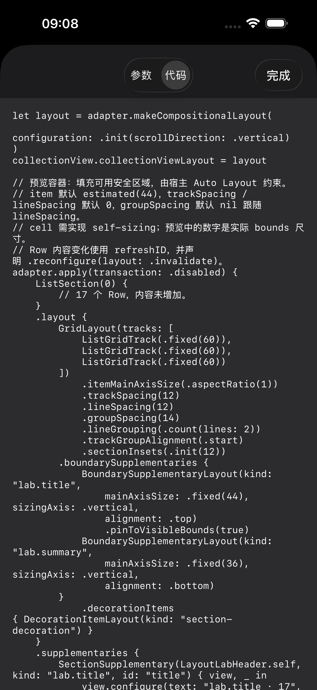
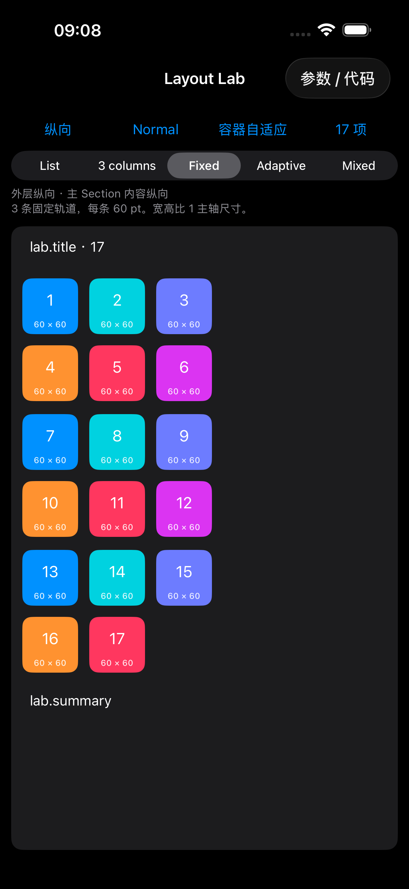
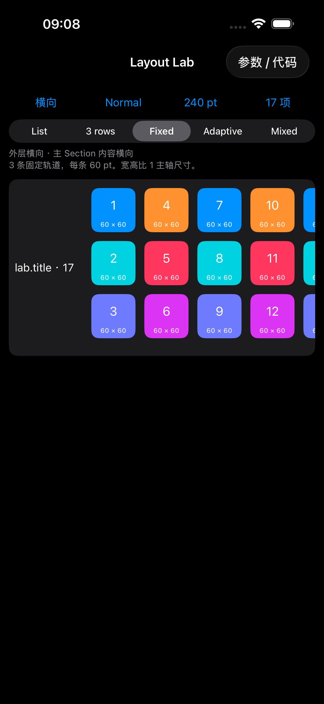
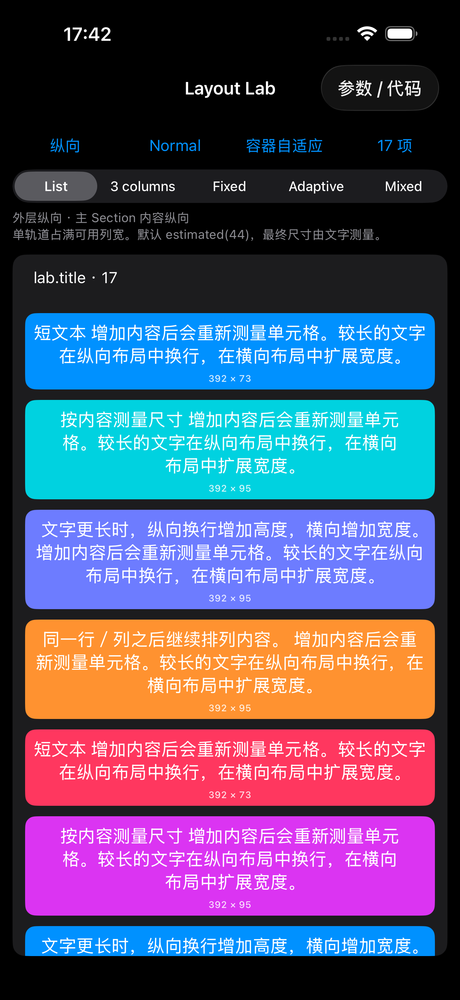

# Layout Lab：参数、预览与布局代码

示例首页点击 **Grid** 打开 `LayoutLabViewController`。页面参考 GridItemSizeLayoutDemo 的集中配置与交互方式，用 ListKit 展示轨道、主轴尺寸、分组和正交滚动。

## 查看调整后的代码

点击右上角 **参数 / 代码**，调整参数后切换到 **代码** 标签。代码随当前配置更新，可以长按选择、复制；关闭面板即可查看实际布局。重新打开面板保留当前参数。

代码包含外层滚动方向、每个 Section 的 Grid 配置、边界布局和装饰布局。它是布局片段，Row 内容和 supplementary 视图注册以注释标明；接入业务时需补上这些内容及对应视图类型。容器的 240 pt 约束属于宿主 Auto Layout，代码中单独标注。

`LayoutLabConfiguration` 保存界面状态，并解析为 `LayoutLabGridRecipe`。同一份 recipe 同时生成实际 Grid 和展示代码，避免参数调整后预览与代码使用不同预设。尺寸、轨道、间距、分组、对齐与滚动方式都有对应输出。

## 可调整的内容

| 入口 | 行为 |
| --- | --- |
| 纵向 / 横向 | 切换外层滚动方向，保留轨道和参数选择；正交场景的内容方向随之反转。 |
| 场景菜单 | 普通 Grid、Cards、Tags、Banner、Measured badges、Centered、2×3、Mixed sections、Native list。 |
| 容器自适应 / 240 pt | 收窄交叉轴：外层纵向时调整宽度，横向时调整高度；受当前安全区域限制。 |
| 项目数量 | 在 17、1、0 项之间循环，观察尾组和空 Section。 |
| 轨道选项 | 单轨道、3 条弹性轨道、3 条固定轨道、自适应轨道、混合轨道；横向显示 3 rows。 |
| itemMainAxisSize | 自适应 `.estimated(44)`、固定 56、宽高比 1、同组统一 `.uniform(estimated: 44)`。同组统一在 iOS 17 起可选。 |
| trackGroupAlignment | 起始、居中、末尾。限制弹性／自适应轨道上限后更容易观察剩余空间中的对齐。单轨道保持占满交叉轴，固定轨道保持固定尺寸。 |
| 每组行／列 | 1～4，结合组内间距观察 lineGrouping。 |
| 间距 | `trackSpacing` 控制轨道间距，`lineSpacing` 控制组内与默认组间距；开启「覆盖组间距」后编辑 `groupSpacing`，关闭恢复跟随。代码只在覆盖启用时输出 `.groupSpacing(...)`。 |
| 边界吸附 | 控制主 Section 标题的 `pinToVisibleBounds`。 |
| 增加内容 | 更新 Row 模型；自适应与同组统一重新测量，固定尺寸和宽高比保持尺寸。 |

普通 Grid 和 Mixed sections 的主 Section 可调整 Grid 参数。其他场景保持各自预设，参数面板显示内容与边界选项；Native list 不添加 Grid 边界或装饰。

示例初始预设使用固定 56 pt、轨道与行间距均为 10 pt，组间距默认跟随行间距，便于区分单元格。这些是示例显式配置。**库默认仍是 `.estimated(44)`，trackSpacing 与 lineSpacing 均为 0，groupSpacing 为 nil。**

每个单元格底部显示实际 `bounds` 的宽 × 高。测量标签不参与 self-sizing，避免显示测量结果反过来改变布局。纵向内容会按交叉轴宽度换行；横向内容按单行文字测量宽度。复用时重新设置测量方向、换行方式和文字宽度。Row 使用 `.refreshID(item)` 和 `.refresh(when: .refreshIDChanges, action: .reconfigure(layout: .invalidate))`，让文字变化触发重新测量。

## 场景与组织

- Cards：固定主轴 92 pt，根据 viewport 计算组容量，停靠到 group 起始边缘。
- Tags：内容自适应尺寸，连续正交滚动。
- Measured badges：两条轨道、每组三条 line，内容按实际尺寸测量，徽标为独立 supplementary；连续正交滚动，点击徽标显示对应 item。支持切换外层方向。测量主轴下的精确分页仍有限制，见 [徽标实现与验证](Measured-Grid-Badges.md)。
- Banner：单 item 填满 viewport group，整页滚动。
- Centered：group 占 viewport 的 84%，居中停靠。
- 2×3：两条轨道、每组三行／列，`fillGroup` 等分尺寸，尾组保留空位。
- Mixed sections：可调整的主 Grid、两轨道固定 72 pt Grid、2×3 正交分页 Grid。
- Native list：`UIKitListLayout(appearance: .insetGrouped)`，使用相同内容模型观察自适应。

文件职责：

- [`LayoutLabViewController.swift`](../Examples/Examples/LayoutLabViewController.swift)：界面与配置绑定、Section 内容与视图注册。
- [`LayoutLabConfiguration.swift`](../Examples/Examples/LayoutLabConfiguration.swift)：配置、场景 recipe、布局代码生成。
- [`LayoutLabParametersViewController.swift`](../Examples/Examples/LayoutLabParametersViewController.swift)：参数控件和可复制的代码面板。
- [`LayoutLabReusableViews.swift`](../Examples/Examples/LayoutLabReusableViews.swift)：单元格测量、尺寸显示及边界、背景视图。

## 实际截图

截图来自 iPhone 17 Pro Max / iOS 26.5 模拟器；不同参数组合对应不同布局。代码、纵向布局和横向布局截图于 2026-10-30 随间距 API 复查更新：轨道与行间距均为 12 pt，纵向截图显式覆盖组间距为 14 pt；横向截图已清除覆盖，组间距跟随 12 pt。

| 实时布局代码 | 调整后的纵向布局 |
| --- | --- |
|  |  |

| 横向与 240 pt 容器 | 增加内容后的自适应 |
| --- | --- |
|  |  |

关闭「覆盖组间距」后，生成代码不再包含 `.groupSpacing(...)`，实际组间距恢复为 lineSpacing；见[清除覆盖后的代码截图](Assets/LayoutLab/inherited-spacing-code.png)。本次间距复查见[统一行间距验证](Layout-Spacing-Validation.md#2026-10-30-复查)。

历史验证范围与结果见 [Layout Lab 验证记录](Layout-Lab-Validation.md)。布局 API 的完整语义见 [布局 API](Layout-API.md)。
