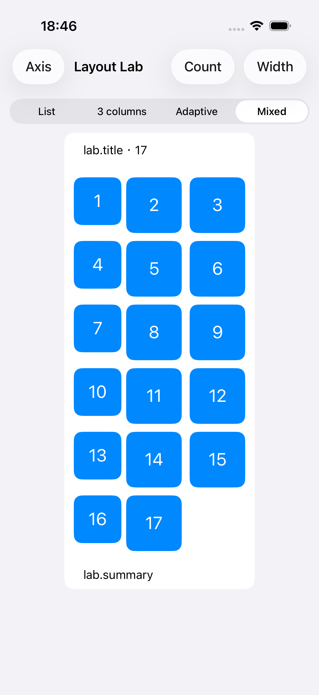
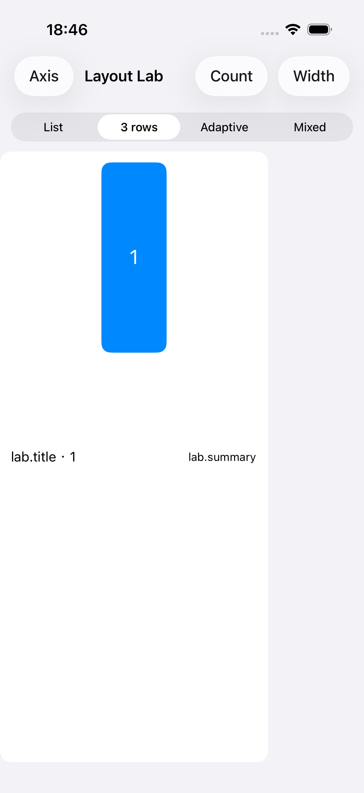
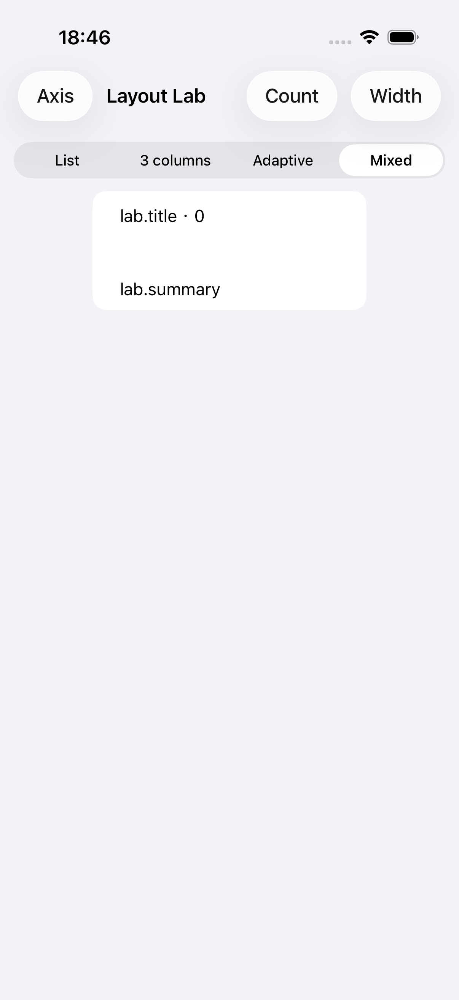

# 整体布局 DSL 验证记录

更新日期：2026-10-29。使用 XcodeBuildMCP、ListKit.xcworkspace、Debug、iPhone 17 Pro / iOS 26.5 Simulator，关闭签名与并行测试。最低部署要求仍是 iOS 15。

本记录对应整体布局与 decorationItems 集合 API。此前 0.5.0 同步的验证不作为本次最终实现通过的证据。

## 2026-10-29 身份替换的正交滚动保持与未启用 kind 隔离（当前实现）

本轮保留实际 kind、Section reload 和纯 refreshID 重配语义，没有新增公共 API。身份替换只对启用的 kind 安排 Section 重载：内建布局检查新几何声明，EnvironmentLayout 在最近一次真实 UIKit 环境中解析新分支，已解析的实际 boundary/item kinds 用于区别“仅注册内容”与“已启用几何”。自定义 provider 自有 boundary 及已显示的自有 item supplementary 继续参与替换，不能仅按屏幕可见性过滤整个 Section。

正交滚动状态以 Section identity 关联。通过宿主 cell 的 UIView 层级找到 UIScrollView，不匹配 UIKit 私有类名、不使用 KVC，也不进入业务 cell 内部的嵌套滚动视图。记录最后的 contentOffset，在身份替换后的布局完成时恢复；屏幕外 Section 的待恢复位置保留到重新展示，删除 Section 时清理状态。恢复受 apply generation 保护，先于调用方显式滚动行为执行；偏移限制在新内容的有效范围内。

新增 `SupplementaryReloadIsolationTests` 共 13 个正式测试，与原有 5 个 `SupplementaryIdentityReplacementTests` 一同保留：

- 两个正交 Section，连续与居中分页两种行为，业务 ID 与视图类型替换、开启与关闭动画事务的组合；核对实际偏移、cell 窗口坐标、外层偏移、选择、未变 Section 的实例，并在 Section 移动后再次核对身份关联。
- 身份稳定后的纯 refreshID 更新：supplementary 实例保持、内容重配、Section reload 为 0、布局失效计数不增加；Row 实例和 prepareForReuse 计数保持。
- 屏幕外正交 Section 更新后返回可见范围仍保留偏移；屏幕外空 Section 使用最新 supplementary 类型。
- 静态未启用 kind、环境分支禁用/重新启用，以及同一次 apply 关闭几何并替换 ID：不产生多余 Section reload，`.never` Row 保持实例、复用计数和临时值。
- 自定义 provider 自有 boundary 和 item supplementary 的替换；无关 kind 不重载 Section。外部 FlowLayout 保留原有身份替换行为，并验证从框架布局切换为 FlowLayout 时不沿用旧元数据。
- 同 Section 的其他 supplementary / Row 各配置一次，跳过重复逐项刷新；其他 Section 保留实例。Row 增删移动时按身份恢复选择，显式滚动锚点保持位置；Outline 展开与子项选择保持。
- 适配器继续存活时，在 UIKit 完成窗口拆卸事务后 collectionView 可以释放，验证新增状态没有破坏弱持有契约。

最终验证：

- **ListKit 全套 256/256 通过，0 失败**，Debug、iPhone 17 Pro Max / iOS 26.5 Simulator。
- 库测试使用 `/tmp/listkit-hosted-validation` 中的临时 App 宿主执行：以 Examples 的测试工程启动空白 UIApplication，测试目录直接链接仓库 `Tests/ListKitTests`，库源码直接链接仓库 `Sources`。没有修改仓库 Xcode 项目配置、没有复制或改写测试断言；此结果是 App 宿主中的库全套验证，不是无宿主 SwiftPM 测试通过的声明。
- **原始 ExamplesUnitTests 44/44 通过**，使用仓库原工程和 iPhone 17 Pro / iOS 26.5 Simulator。
- **Swift 6 / arm64 iOS 15 Simulator 编译契约通过：8 个正例、15 个预期拒绝例**。这不代表 iOS 15 运行时验收。
- `git diff --check` 通过；未提交、未推送。

最终结果路径：

- 库全套：`/tmp/listkit-reload-acceptance.xcresult`，日志 `/tmp/listkit-reload-acceptance.log`。
- 最后一次功能专项（加入生命周期测试前）：`/tmp/listkit-reload-hosted-focused-v3.xcresult`，16/16 通过；最终全套还包含生命周期与外部 FlowLayout 测试。
- 生命周期专项：`/tmp/listkit-reload-lifetime-v2.xcresult`，1/1 通过。
- 原始示例：`/tmp/listkit-reload-examples-acceptance.xcresult`，日志 `/tmp/listkit-reload-examples-acceptance.log`。
- 编译契约：`/tmp/listkit-api.ykROIZ`，汇总 `/tmp/listkit-reload-api-acceptance.log`。

保留的失败与诊断证据：

- 审查时的未启用 kind 多余重载：`/tmp/listkit-reload-review.log`；正交偏移 600 → 0：`/tmp/listkit-reload-review-orthogonal.log`。
- 首次编译使用了 UIKit 不公开的 section.group 属性，随后改为可访问的 boundary 与声明的 item 元数据：`/tmp/listkit-reload-fix-first.log`。
- iOS 26.5 的两次无宿主运行在首个 UIWindow 初始化处超时，未进入 ListKit 更新断言：`/tmp/listkit-reload-fix-focused.log`、`/tmp/listkit-reload-fix-max.log`。进程采样 `/tmp/listkit-reload-fix-max-stall.txt` 显示 UIScreen/UIApplication 初始化等待系统 XPC；中断后改用 App 宿主。
- 第一版 iOS 27 无宿主运行最终进入测试，与首轮 App 宿主结果一样暴露屏幕外偏移未保存及分页测试基准问题：`/tmp/listkit-reload-fix-ios27.xcresult`、`/tmp/listkit-reload-hosted-focused.xcresult`。补齐屏幕外状态记录；分页测试改为比较 UIKit 吸附后的实际更新前偏移，保留 cell 窗口坐标检查，没有放宽位置保持断言。
- 首次全套为 254 通过、1 个生命周期测试失败：`/tmp/listkit-reload-hosted-full.xcresult`。测试最初只 Task.yield，没有等待 UIKit 窗口拆卸事务；加入 run-loop teardown 等待后专项及最终全套通过，生产持有关系未因此改动。

本轮未进行真机、Release、iOS 15 runtime 或完整 Examples UI suite 验收。动画事务验证最终状态，不代表动画中间帧验收；也没有承诺保留 Row 内部临时状态、输入焦点或编辑内容。最新实现的完整运行证据来自 iOS 26.5 App 宿主，iOS 27 的中间失败记录不作为最终实现通过的证据。

## 2026-10-29 同 kind 的 supplementary 身份替换基础修复

修复同一 Section、相同 kind 和几何下，supplementary 业务 ID 或视图类型变化后仍显示旧内容/旧类型的问题。Collection adapter 在替换查找表前比较该 Section + kind 的新旧 identity，将发生替换的已有 Section 交给 apply planner 重载。多个 kind 的替换合并为一次 Section reload，并与该 Section 的 Row snapshot 刷新互斥。这是结构更新，即使 refreshID 不变且刷新策略为 `.never` 也执行；重载会覆盖该 Section 的 Row。

新增正式 `SupplementaryIdentityReplacementTests`，共 5 个测试：

- boundary / item supplementary 分别覆盖业务 ID 和视图类型替换；每条路径运行开启动画、关闭动画两种 transaction。
- 在真实 UIWindow / UICollectionView 中验证实际内容与视图类型；类型变化后不能继续使用旧实例，同类型更换业务 ID 允许 UIKit 正常复用，但必须配置新内容。
- 替换前选中 Row 并滚动至非零位置；替换及后续 refreshID 更新后，检查选中项、垂直 contentOffset（1 点容差）与 cell frame 保持。
- 单独验证仅改变刷新策略不会触发刷新，再单独改变 refreshID：原 supplementary 实例保留、内容重配、Section reload 为 0、布局失效计数不增加。
- 同 Section 多个 kind 的替换只重载一次；未改变的 Section 保留原视图，新增/删除 Section 不被误判为身份替换。

验证环境为 Debug、iPhone 17 Pro / iOS 26.5 Simulator，关闭并行测试：

- **库全套 243/243 通过，0 失败**，包含新增 5 个正式测试及已有 Table/Collection 回归。随后仅加强测试中的“策略变化”与“纯 refreshID 变化”分离断言，再运行专项 **5/5 通过，0 失败**；生产实现未再改变。
- **ExamplesUnitTests 44/44 通过，0 失败、0 跳过**。
- **Swift 6 / arm64 iOS 15 Simulator 编译契约：8 个正例、15 个预期拒绝例通过**。
- `git diff --check` 通过。未提交、未推送。

结果与原始证据：

- 修复前审查复现：`/tmp/listkit-kind-review-isolated.log`；简化前实现的对照复现：`/tmp/listkit-kind-review-before.log`。两次均复现业务 ID / 视图类型替换失败，保留为历史失败证据。
- 库全套：`/tmp/listkit-identity-full.xcresult`，日志 `/tmp/listkit-identity-full.log`。
- 最终专项：`/tmp/listkit-identity-final-focused.xcresult`，日志 `/tmp/listkit-identity-final-focused.log`。首个跨 Section 测试约 50 秒，明显慢于全套运行中的同一测试；原因尚未确认，最终无崩溃或断言失败。
- 示例：`/tmp/listkit-identity-examples.xcresult`。
- 编译契约：`/tmp/listkit-api.NxKpAe`，汇总 `/tmp/listkit-identity-api.log`。

本轮没有重跑 Examples UI suite；新增测试是真实 UIKit 渲染集成测试，不等同于 UI 自动化操作。没有 iOS 15 runtime、真机、Release 或动画中间帧验收；选择与滚动保持结论限定于上述固定几何测试场景。

## 2026-10-29 移除 Slot，直接按 kind 关联

本轮同时移除 `SupplementarySlot` 与 `DecorationSlot`。supplementary 直接以实际 kind 关联内容和几何；decoration 以逻辑 kind 关联注册和几何，保留逻辑 kind 到实际 elementKind 的解析。示例和当前 API 文档直接使用业务名称，不保留旧默认 `ListKit.Supplementary.` / `ListKit.Decoration.` 前缀；这是有意的 identity / 注册标识变化。下方历史记录描述的是当时实现，不作为当前 API 用法。

最终验证环境：Debug、iPhone 17 Pro / iOS 26.5 Simulator；库与示例运行关闭并行测试。

- **库全套 238/238 通过，0 失败**，含新增的 5 个 KindAssociationTests。覆盖现有布局、内容刷新、条件内容、同侧多 boundary、自定义布局、typed/manual decoration 冲突、跨 Section 注册与视图类型替换。
- 新增真实 UIWindow/UICollectionView 测试从旧带前缀的描述切换到无前缀描述：验证 supplementary identity 和 decoration 实际 elementKind 改变、header 与 decoration 实例被替换、旧视图和 attributes 消失、新 attributes 可查询；同时验证选择、滚动位置和 cell 几何保持稳定。
- 新 kind 稳定后仅改变 refreshID，验证复用并重配现有 header，不额外失效布局；验证内容移除与重新插入。直接内容工厂和包装已有 Supplementary 的入口保留显式 kind、业务 identity 与刷新规则；相同 kind 在不同 Section 中按各自内容路由。
- **ExamplesTests 44/44 + LayoutLabUITests 2/2 通过，0 失败、0 跳过**。UI 路径覆盖横纵轴自定义 boundary，以及网格模式、宽度和空内容切换；截图保存在结果 bundle 附件中。
- **Swift 6 / arm64 iOS 15 Simulator 编译契约通过：8 个正例、15 个预期拒绝例**。两个旧 Slot 类型的失败原因已核对为符号不存在；没有兼容别名。iOS 15 为编译验证，没有运行时验收。
- `git diff --check` 通过。

最终结果：

- 库：`/tmp/listkit-kind-final-tests.xcresult`，日志 `/tmp/listkit-kind-final-tests.log`。
- 示例与 UI：`/tmp/listkit-kind-final-examples.xcresult`。
- 编译契约：`/tmp/listkit-api.zCL36K`，汇总 `/tmp/listkit-kind-final-api.log`。

中途记录保留：最初保留旧前缀的库运行在 decoration 冲突测试期间异常退出并重启，随后结果收集未结束；更新迁移策略后已取消该进程。日志 `/tmp/listkit-kind-package-tests.log` 保留，不计入最终通过证据。旧策略的示例 44/44 结果也不替代上述最终结果。没有修改诊断规则来放宽冲突要求；最终全套重新验证已通过。

本轮没有 iOS 15/16 runtime、真机、Release、完整 Examples UI suite 或 iPad 多窗口验收。历史截图未替换，不将其作为本轮新截图。

## 2026-10-29 UIKitGridLayouts 命名对齐

本轮将轨道定义、主轴尺寸与内部构建器对齐为 `ListGridItem`、`ListGridSize`、`ListGridLayoutBuilder`，固定主轴尺寸使用 `.fixed`，对齐偏移使用 `offsetFraction`。旧类型名与 `.absolute` 工厂已删除，不保留 deprecated 或 typealias。逐文件对照修改前的工作区，14 个 Swift 文件均仅包含命名替换；既有未提交改动得到保留。

- 最终源码在 iPhone 17 Pro / iOS 26.5 Simulator、Debug、关闭签名与并行测试下编译成功，相关回归 **75/75 通过，0 失败、0 跳过**：TrackResolutionTests、MainAxisSizingTests、DeclarativeLayoutTests、LayoutBoundaryTests、CompleteSectionLayoutTests。覆盖轨道规则、两轴 estimated/uniform/比例测量、辅助视图、环境尺寸变化及完整布局。
- Swift 6 / arm64 iOS 15 Simulator 编译契约通过：8 类正例、14 类预期编译拒绝。新增新名称正例，以及 `GridTrack`、`ListGridItemSize`、`ListGridSize.absolute` 三个旧名称独立拒绝例；已核对失败原因均为对应符号不存在。日志目录：`/tmp/listkit-api.zdS3Qp`。
- 示例 App 与测试 target 编译成功，`ExamplesUnitTests` **44/44 通过，0 失败、0 跳过**，环境同上；包含迁移后的布局及直播间模型用例。结果：`~/Library/Developer/XcodeBuildMCP/workspaces/ListKit-1de09571a095/result-bundles/test_sim_2026-10-29T02-44-43-547Z_pid24555_39639dc4.xcresult`。
- 本轮未重跑全库测试、UI 自动化或真机测试；iOS 15 仅验证编译兼容性，没有旧系统运行验收。上述模拟器布局测试包含真实 UIKit 测量，不等同于完整示例 UI 验收。

最终布局测试结果：`~/Library/Developer/XcodeBuildMCP/workspaces/ListKit-1de09571a095/result-bundles/test_sim_2026-10-29T02-42-50-160Z_pid24555_cc1915ff.xcresult`。以下各节保留之前各轮验证记录，不作为本轮重跑结果。

## 验证层次

| 检查 | 结果 | 范围 |
| --- | --- | --- |
| CompleteSectionLayoutTests（本轮） | 26/26 通过 | 包含持续启用时 768 → 600 的独立几何断言、CustomLayout context 手动标识更新及移除断言 |
| ListKit 全套测试（上一轮，本轮未重跑） | 231/231 通过 | 既有框架回归、整体值模型、诊断、状态更新以及真实 UIKit 几何 |
| ExamplesUnitTests（上一轮，本轮未重跑） | 44/44 通过 | 最终源码与示例构建、模型回归；包含 Mic seats 具名槽位迁移 |
| Examples / LayoutLabUITests（2026-10-28，本轮未重跑） | 2/2 通过 | 实际启动、切换主体/轴、改变宽度与数量；检查视图 frame，保存八个状态附件 |
| Scripts/check-layout-api.sh（上一轮，本轮未重跑） | 7 类正例、11 类预期编译拒绝通过 | Swift 6、arm64 iOS 15 Simulator 编译，不是 iOS 15 runtime 验证 |
| inset 环境重解析专项 | 1/1 通过 | contentInset 改变与 RTL 切换后 provider 重新执行 |

编译正例覆盖内建/环境布局、Optional、完整修饰链、CustomLayout inset 上下文、数组/循环 builder。拒绝例覆盖并列主体、旧背景/Header 入口、旧布局 ID/直接配置重载、错误主体尺寸方法、无保护 uniform、item 吸顶及内容侧几何修饰。decorations 已改为集合，多个不同槽位的装饰是有效用法。

## 2026-10-29 审查修复

- adaptive 总展开数量上限及比例溢出、非有限轨道总宽度，在环境解析阶段返回 diagnostics；修复后可继续 apply 合法布局，诊断清空。通用算法保留合法窄容器、maximum 和间距规则。
- UIKit List 对 `.whenPresent()` 按实际存在的内容判断限制，静态与环境选择器在内容存在/缺席四种情况下保持一致。原生 List 的运行测试使用真实 UIWindow/environment，不能用简化的 NSCollectionLayoutEnvironment mock 替代 UIKit 所需环境。
- Supplementary 内容 builder 支持直接 Optional 表达式，编译脚本覆盖 present/nil 与普通内容混合。
- 清理旧单值背景 builder、Header/Footer role 和自动 inset 补偿的残留说明与死代码。
- 新测试先复现了装饰类型 A → B 后屏幕仍保留 A 的问题。typed 装饰现在以逻辑 kind + 视图类型生成实际 UIKit elementKind；逻辑 kind 和 slot 不变。手动注册原样使用实际 elementKind。自定义 provider 通过 `context.decorationElementKind(for:)` 查询实际注册 kind。

本轮新增 6 个测试。渲染测试在同一 UICollectionView/layout 中依次执行 A → B → 移除边界 → 移除装饰，覆盖 240/390/768 点宽度。断言具体视图类型、旧实例消失、attributes 移除、cell frame 回收边界空间，以及替换时 layout 实例、可见 cell 实例、选中状态和非零 contentOffset 保持不变。移除时保留内容注册，确保验证的是几何更新，而非依靠删掉内容重载 Section。

测试截图使用蓝色 A、橙色 B 和透明 cell/边界。截图证明捕获时的颜色变化与装饰消失；边界移除和 cell 位置由真实 attributes/视图断言验证，不从纯色截图推断几何。

[装饰 A](Screenshots/review-decoration-a.png) · [装饰 B](Screenshots/review-decoration-b.png) · [移除边界](Screenshots/review-boundary-removed.png) · [移除装饰](Screenshots/review-decoration-removed.png)

首次失败证据：`test_sim_2026-10-29T01-19-08-566Z_pid72386_939f667b.xcresult`，包含装饰类型替换断言失败及原生 List 测试 mock 环境断言。最终全套结果见下方路径；中途失败结果不作为通过证据。

## 2026-10-29 kind / elementKind 二次审查修复

- `DecorationSlot.defaultKind` / `SectionDecoration.kind` 表示逻辑名称。typed 实际 `elementKind` 包含视图类型；手动入口改为 `SectionDecoration(slot:elementKind:)`，逻辑名称来自 slot。旧命名没有兼容转发。
- 跨 Section 注册校验改用实际 elementKind；provider 与框架装饰共存也仅按实际 elementKind 检查物理冲突。
- 同一 Section 当前启用的 typed/manual 几何如果使用相同实际标识，在静态 apply 前拒绝；未启用的槽位允许保留。环境选择器在真实解析后校验，恢复合法布局后清除诊断。
- 手动 elementKind 纳入值相等、哈希和布局签名；仅改变手动注册标识也会更新布局。
- 新增 5 个测试：2 个模型/解析测试和 3 个真实 UIWindow 渲染测试。多 Section 在 240/390/768 点宽度执行 A/A → A/B → A/A，检查具体视图类型、真实 attributes、layout/cell 实例、选中项和非零滚动位置。自定义装饰共存覆盖相同宽度及 A → B → A，检查两种实际 kind、不同 zIndex、20 点 inset 和实际视图 frame。typed/manual 冲突测试检查拒绝前后的可见视图与 cell 保持、修复后共存、只替换手动 elementKind 以及移除后的状态。

最终库全套 231/231、ExamplesUnitTests 44/44 通过。编译契约新增 defaultKind、实际 elementKind 正例，以及旧 slot.elementKind / 手动 kind: 入口拒绝例，共 7 类正例和 11 类预期拒绝；日志目录 `/tmp/listkit-api.Lcdoe0`。

截图来自最终通过的 result bundle；蓝色是 typed A、橙色是 typed B、绿色是手动/provider 装饰。已核对多 Section A/B 与 provider/typed 共存截图，位置和层级同时由真实 UIKit attributes 和视图断言验证。

[多 Section A/B](Screenshots/review-kind-multi-section-a-b.png) · [恢复 A/A](Screenshots/review-kind-multi-section-a-a.png) · [自定义与 typed B 共存](Screenshots/review-kind-custom-coexist-b.png) · [恢复 typed A](Screenshots/review-kind-custom-coexist-a.png) · [冲突拒绝后保持原布局](Screenshots/review-kind-typed-manual-rejected-preserves-layout.png) · [修复冲突后共存](Screenshots/review-kind-typed-manual-recovered.png) · [移除手动几何](Screenshots/review-kind-typed-manual-removed.png)

中间失败与处理均保留：

- `test_sim_2026-10-29T01-54-35-436Z_pid72386_3351be37.xcresult` 与 `test_sim_2026-10-29T01-56-15-161Z_pid72386_8b0623e3.xcresult`：新测试错误地将两个 decoration 都按 item 0 查询。运行日志确认 UIKit 分配的实际 indexPath 为 item 0 和 item 1，实际视图已正确显示。修正测试为按返回的 attributes 获取 indexPath，并增加实际视图 frame 交叉断言，未降低几何/层级要求。
- `test_sim_2026-10-29T01-57-44-531Z_pid72386_f39eb44d.xcresult`：全套首个既有 Context Menu 测试停在 UICollectionView 初始化。进程采样显示 UIKit 等待系统显示初始化 XPC；中断该次运行，result bundle 保存也报超时，不能作为完整测试结果。日志与 `/tmp/listkit-decoration-review-xctest-hang.txt` 保留；随后使用单测试 60 秒超时运行。
- `test_sim_2026-10-29T02-02-36-380Z_pid72386_ee3e64c5.xcresult`：229 通过、2 失败；三个新增真实渲染用例均通过。失败分别是未迁移的手动 kind 旧断言，以及新增环境恢复测试未等待 apply 完成。修正断言与测试等待，不修改生产更新流程。

## 2026-10-29 渲染测试覆盖补齐

本轮只改测试、背景常量注释和验证材料，未调整布局运行实现。`CompleteSectionLayoutTests` 在 iPhone 17 Pro / iOS 26.5 Simulator 上 **26/26 通过**，0 失败、0 跳过；编译了当前库和测试 target。未重跑全库、Examples 或 iOS 15 编译契约，前面的全量记录保留为上一轮证据。

- 修正手动装饰移除断言：最后实际显示的是 `ReplacementDecorationB`，现在同时断言 B 消失、`manual-orange` attributes 不存在、唯一剩余 decoration 是 typed A，并核对其视图 frame、cell frame 和 diagnostics。
- `testRenderedEnvironmentDecorationSwitchesOnContainerWidthAlone` 只执行一次 apply，使用同一个 collection/layout 和固定 selector ID。保持窗口为 768 点宽，只将 collection 从初始 240 点依次调整到 390 → 768 → 390 → 768 → 240；不手动 invalidate，不更换内容。断言 provider 重新解析、实际环境宽度、装饰 attributes/视图在 500 点阈值两侧的添加/移除/恢复、cell 宽度、选中状态和 20 点滚动偏移；确认 adapter 的 apply 布局失效计数未增长。
- `testRenderedCustomContextReadsUpdatedManualElementKind` 在 240/390/768 点容器中复用同一个 CustomLayout/provider/ID。provider 只捕获 slot，通过 context 查询实际 kind；仅内容侧 elementKind 按绿色 → 橙色 → 绿色更新。断言每次 provider 调用读到当前标识、旧视图和旧 attributes 消失、新视图 frame/zIndex 正确，以及 layout/cell 实例、选中项、cell frame 和滚动位置保持。
- `elementKindSectionBackgroundDecoration` 注释明确为可供手动注册使用的常量，不是 typed SectionDecoration 的默认实际标识。

截图由本轮通过的结果包导出，已核对显示/隐藏、橙色替换与绿色恢复，以及仅剩蓝色 typed A 的移除结果。透明 cell 使截图主要呈现装饰颜色；精确几何和状态保持由真实 UIKit attributes/视图断言验证。

[宽容器显示](Screenshots/review-followup-environment-width-1-768.png) · [变窄后移除](Screenshots/review-followup-environment-width-2-390.png) · [再次变宽恢复](Screenshots/review-followup-environment-width-3-768.png) · [context 更新为橙色](Screenshots/review-followup-custom-context-orange.png) · [context 恢复绿色](Screenshots/review-followup-custom-context-green.png) · [手动装饰移除后仅剩 typed A](Screenshots/review-followup-typed-manual-removed.png)

首次测试构建因记录观测宽度的 Void 表达式不符合单值布局 builder 契约而失败；调整为局部声明记录观测值后通过，没有放宽 DSL。原始构建日志保留为 `test_sim_2026-10-29T02-18-17-359Z_pid72386_7a974ad0.log`。

## 2026-10-29 持续启用时的装饰几何补齐

本轮仅补强既有渲染测试，未改动运行实现。容器序列从初始 240 点变为 **390 → 768 → 600 → 390 → 768 → 240**，仍然只 apply 一次、不更换 selector ID 或 layout、不手动 invalidate。768 → 600 两步均启用装饰；隐藏后恢复到 768 点，再与首次 768 点的实际 attributes/view frame 比较。

独立预期以 20 行 × 40 点行高、零间距、Section 上下各 8 点 inset 计算：Section 高度 816 点；装饰四边各缩进 12 点，预期高度为 792 点。768 点容器预期 frame 为 `(12, 12, 744, 792)`，600 点容器预期为 `(12, 12, 576, 792)`，均使用 collection 内容坐标。测试分别核对 UIKit attributes 和实际视图相对独立预期的 frame，另外断言四边 12 点间距与 744/576 点宽度，不仅比较视图和 attributes 彼此相等。两次 768 点访问计数也必须为 2，避免恢复比较被跳过。

当前库/测试 target 编译成功；`CompleteSectionLayoutTests` 在 iPhone 17 Pro / iOS 26.5 Simulator 上 **26/26 通过，0 失败、0 跳过**。已导出并核对[首次 768 点](Screenshots/geometry-width-768.png)、[持续启用缩至 600 点](Screenshots/geometry-width-600.png)、[恢复 768 点](Screenshots/geometry-width-restored-768.png)。截图带有 20 点滚动偏移，四边几何由内容坐标中的真实 attributes 和视图断言确认。

未重跑全库、Examples、iOS 15 编译契约；没有新增旧系统 runtime、真机或动画中间帧验收。

## 模型与实际渲染的区别

- CompleteSectionLayoutTests 覆盖值复制、完整替换、集合替换、槽位/kind 关联、条件缺席、重复声明、跨 Section decoration 注册共享与冲突、环境完整布局选择、自定义 inset 所有权、纯刷新与几何失效的区别，以及在创建 UIKit item 前拦截无效尺寸。
- 真实 UIWindow/UICollectionView 几何矩阵覆盖 240/390/768 点宽度，0/1/2/7/60 项，0/10 点间距和非对称 Section inset；检查实际 cell、boundary 和 decoration attributes。长内容滚动至 150 点后验证边界吸顶。
- 多个同侧 boundary 使用显式 offset，实际测量两者 frame 不相交。不能据此推导任意同侧声明会像 VStack 一样自动排列。
- 调整 Collection contentInset 后验证环境 provider 重新执行；不假设 UIKit effectiveContentSize 必须减少同样数值，也不二次扣减安全区域。RTL 切换验证重新解析；原有混合轨道 RTL 测试继续检查真实视图窗口坐标。
- 原有 GridTrackResolutionTests 保留轨道分配边界测试；DeclarativeLayoutTests 和 GridMainAxisSizingTests 继续覆盖 adaptive 阈值、混合轨道、两轴、estimated/uniform、比例、尺寸变化和自定义布局。它们包含真实 UIKit 测量，不能全部称为纯模型测试，也不能全部称为 UI 自动化。

## 有意调整与本轮修复

- 删除 Header/Footer 角色推断，位置仅由 alignment 决定；显式主轴尺寸继续支持比例与独立 estimated 测量。
- 删除非扩展边界的隐藏 inset 补偿，Section inset 保持声明值；extendsBoundary 和 offset 按 UIKit 行为处理。
- Supplementary 内容不再保存几何；装饰布局为 decorationItems，注册为 decorations。重复调用替换集合，显式空集合关闭装饰，省略集合使用已声明装饰的默认几何。
- 对自定义 provider 返回的 inset、boundary 和 decoration 所有权做检查，避免事后覆盖或重复安装。
- 修复只改变 Collection inset 时 provider 未重新解析的问题，保留 bounds、布局方向和 trait 变化检查。
- 将无效尺寸/容器诊断放到 UIKit item 创建之前，避免先进入 UIKit 参数断言。

## 截图与可交互示例

示例首页的 **Grid** 或启动参数 `-LayoutLab` 打开 Layout Lab。List / 3 columns / Adaptive / Mixed、Axis、Width、Count 控件均保留。

人工检查了本轮混合窄容器、横向边界与空 Section 截图：补充视图与 cell 无意外覆盖，装饰覆盖符合 Section 几何。截图只证明捕获状态，滚动吸顶证据来自几何测试。

| 混合轨道 | 横向边界 | 空 Section |
| --- | --- | --- |
|  |  |  |

## 本机结果路径

路径均位于 `~/Library/Developer/XcodeBuildMCP/workspaces/ListKit-1de09571a095/result-bundles/`：

- 本轮几何补强后的布局测试：`test_sim_2026-10-29T02-35-33-988Z_pid72386_5dc17426.xcresult`。
- 上一轮宽度/context 布局测试：`test_sim_2026-10-29T02-18-36-250Z_pid72386_a728b1fc.xcresult`。
- 上一轮库全套：`test_sim_2026-10-29T02-04-52-510Z_pid72386_eced9a40.xcresult`。
- 示例模型：`test_sim_2026-10-29T02-06-39-549Z_pid72386_1c7ff882.xcresult`。
- UI：`test_sim_2026-10-28T10-44-56-621Z_pid32006_f1be0878.xcresult`。
- inset 专项：`test_sim_2026-10-28T10-51-38-148Z_pid32006_0670f013.xcresult`。

## 未验证范围

没有 iOS 15/16 runtime、真机、Release 或完整 Examples UI suite 的验收。768 点是实际测试容器宽度，不等于 iPad 模拟器多窗口验收。没有穷举 Dynamic Type、旋转、所有安全区域和复杂自定义 group 树。uniform 的运行证据来自 iOS 26.5；iOS 17 以下由 API 可用性限制保护。没有 SwiftUI 像素等价承诺。
