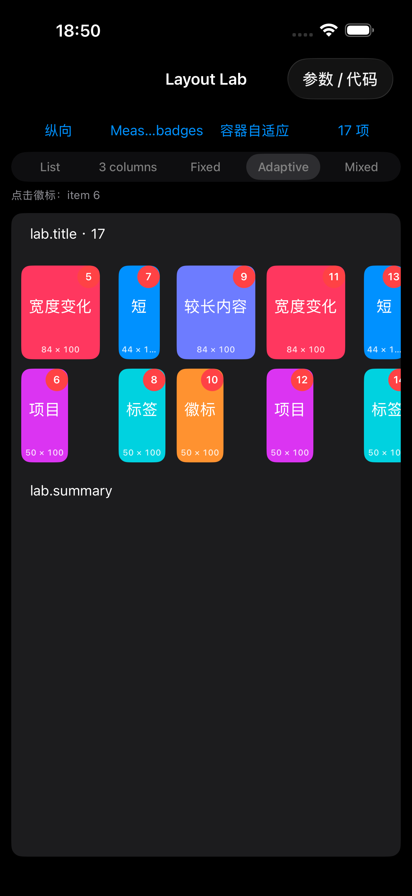
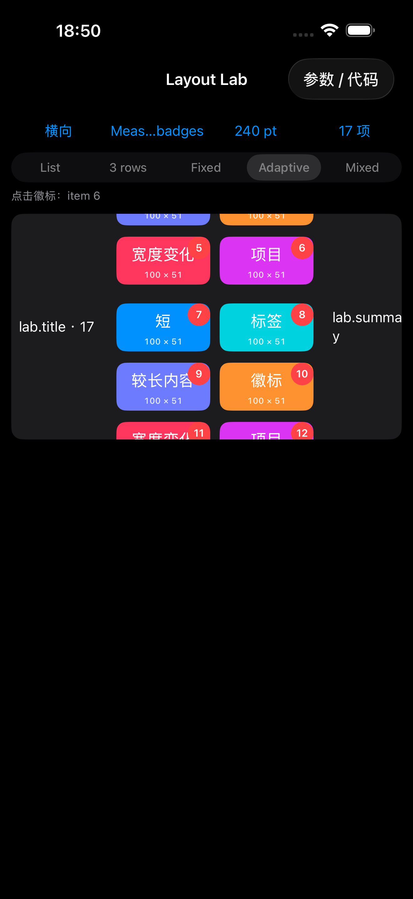

# 自适应多行／多列 Grid 的 supplementary 徽标

日期：2026-10-29。实现与回归环境：iPhone 17 Pro Max 模拟器，iOS 26.5。

## 实现结果与边界

同构轨道的 `estimated` / `uniform` 主轴尺寸现在支持 `.lineGrouping(.count(lines: n))` 与独立 item supplementary 同时使用。基本行／列依次按实际内容测量，保留 lineSpacing、groupSpacing、尾组占位和所属 item 的徽标定位。外层 collection 为横向或纵向、内容沿主轴或正交滚动均有运行验证。

这项支持不等于精确动态分页已经完成。真实手势复现发现，iOS 26.5 的 `groupPaging` 和 `continuousGroupLeadingBoundary` 会继续使用初始估算 group 长度吸附。自适应几何、徽标和业务映射已经支持，估算主轴下的精确停靠仍未解决。Demo 使用 `continuous` 展示已验证的能力。

异构轨道仍不支持重复 item supplementary kind。`uniform` 要求 iOS 17 及以上，其统一范围是一个基本行／列，不是整个多 line group。固定容量 fitting 或显式固定 group 长度与估算主轴的组合仍按原有规则诊断。

## UIKit 地址与业务地址

每条基本 line 使用独立的内部 elementKind，UIKit 因而可以测量显式排列的子 group，而不会复用同 kind 的 supplementary 编号。UIKit 按每个 elementKind 独立编号，不能仅替换 kind 后继续沿用 item indexPath。

对于 T 条轨道、L 条 line、当前 line 为 s、UIKit supplementary 局部编号为 p：

```text
业务 item = (p / T) * (L * T) + s * T + p % T
UIKit supplementary = (item / (L * T)) * T + item % T
所属 line = (item / T) % L
```

以上除法为整数除法。adapter 负责转换，业务声明仍使用同一个 kind。configure、onTap、onDisplay、onEndDisplay 以及可见刷新使用所属 item 位置；dequeue 和原始 UIKit delegate 使用实际 UIKit 地址。kind 按 Section、视图展示类型和分组模板隔离，轨道数变化后重新解析当前映射。

## 使用与迁移

```swift
GridLayout(tracks: 2)
    .itemMainAxisSize(.estimated(44))
    .gridCrossAxisSize(.fixed(210))
    .lineGrouping(.count(lines: 3))
    .trackSpacing(10)
    .lineSpacing(12)
    .groupSpacing(20)
    .orthogonalScrolling(.continuous)
    .itemSupplementaries {
        ItemSupplementaryLayout(
            kind: "badge",
            size: .init(width: .absolute(16), height: .absolute(16)),
            itemAnchor: .topTrailing)
    }
```

typed `SectionSupplementary(BadgeView.self, kind: "badge", id: ...)` 自动适配，无须逐 line 声明多份内容。

自定义 provider 改用四参数重载；`indexPath` 与 `elementKind` 一起用于 dequeue，`context.indexPath` 用于业务内容：

```swift
ProviderSupplementary("badge", id: "badge", view: BadgeView.self) {
    collectionView, elementKind, indexPath, context in
    let view = collectionView.lk.dequeue(BadgeView.self, ofKind: elementKind, for: indexPath)
    view.configure(item: context.indexPath.item)
    return view
}
```

自定义 register 接收实际 elementKind。旧三参数 provider 在不需要映射的原有布局中保持可用；在 measured 多 line badge 布局中明确诊断并提示迁移，避免以业务 kind 错误 dequeue。

需要直接调用 UIKit 查询时，使用 `adapter.supplementaryElement(ofKind:at:)` 返回的 `elementKind` 和 `indexPath`。该地址只适用于当前已解析的布局，数据、方向或容器变化后重新查询。完整契约见 [布局 API](Layout-API.md)。

## Demo 与截图

入口：示例首页 **Grid → 场景菜单 → Measured badges**。切换纵向／横向可观察相反方向的内容滚动；横向外层下选择 240 pt 容器可产生垂直滚动范围。点击徽标后顶部显示对应的零起始 item 编号，徽标文字为该编号加 1。

| 纵向外层、横向内容 | 横向外层、纵向内容 |
| --- | --- |
|  |  |

截图来自真实 UI 滑动及点击测试后的状态，证明连续滚动时的徽标和业务事件；不作为分页吸附证据。测试入口参数为 `-LayoutLab`，具体启动配置以 LayoutLabUITests 为准。

## 验证结果

| 检查 | 结果 | 证据 |
| --- | --- | --- |
| ListKit 完整测试 | 通过：309 项，0 失败 | `/tmp/listkit-measured-badges-final.xcresult` |
| Demo 单元测试 | 通过：53 项 | `/tmp/listkit-measured-badges-demo-final.xcresult` |
| Layout Lab 真实手势 | 通过：8 项，含新增双方向徽标滑动、点击及已有固定尺寸分页 | 同上 |
| iOS 15 API 编译契约 | 通过：84 项，22 项编译成功、62 项按预期拒绝旧／非法 API | `/tmp/listkit-measured-badges-api.log` |
| DocC | 通过：BUILD DOCUMENTATION SUCCEEDED | `/tmp/listkit-measured-badges-docs.log` |
| estimated 主轴精确吸附 | 失败、未解决：groupPaging 与 continuousGroupLeadingBoundary 均复现 | 下述 demo2 / leading 结果 |
| 真机、iOS 15/17 runtime、estimated groupPagingCentered | 未执行 | 最低系统只做 API 编译验证 |

已核对两份最终 xcresult：均为 0 失败、0 跳过，runtimeWarnings 为空。

库回归覆盖双外层方向 × 主轴／正交 × estimated／uniform 的 8 种组合，以及尾组、可见刷新、按 row identity 刷新、重排与重新测量、身份／视图类型替换、Section 隔离、RTL、轨道数量变化、3→2→3 自适应容器变化、provider 地址及旧 provider 诊断。Dynamic Type 运行测试也覆盖带／不带徽标。

UIKit 原型测试保留最低 iOS 15 的 subitem/count API，会产生 iOS 16 弃用警告。最终完整测试后仅为原型测试局部 helper 补充 MainActor 注解，另用 `/tmp/listkit-measured-badges-prototype-final.xcresult` 复验；未以编译通过替代运行验证。

## 分页失败的具体证据

三条 line 的初始主轴估算为 `3 × 44 + 2 × 12 = 156`，组间距为 20，原生吸附使用 176 点步长。实际横向 group 测量为 242 点，应使用 262 点步长，停靠相差 86 点；纵向 group 测量为 177 点，应使用 197 点步长，停靠相差 21 点。

`groupPaging` 和 `continuousGroupLeadingBoundary` 均出现这一偏差。ListKit 仍原样传递调用方指定的原生行为，不偷偷替换；最终 Demo 改为 continuous，并将新 UI 用例明确限定为连续滑动、徽标定位和点击。原有固定尺寸分页断言保留。没有放宽原失败用例的容差来宣称分页通过。

精确动态分页需要进一步设计测量结果缓存或滚动协调，并验证动态内容、旋转、尾组、RTL 和触摸减速；本轮没有引入这些机制。

## 失败记录与工作区保护

所有结果前缀为 `/tmp/listkit-measured-badges-`：

- prototype：原型使用旧 CustomLayout 参数导致编译失败，改为 layoutKey。
- prototype2 / prototype3：把 supplementary 局部编号当作 item 编号导致断言失败，运行输出确认 UIKit 的按 kind 独立编号；prototype4 通过。
- integration2：测试误将同步 apply 当作 await 使用，导致验证发生在更新完成前；改用真正的异步 apply 并为负例独立建夹具，integration3 通过。
- demo1：测量分页失败，横向外层用例还存在内容未超出 viewport 的夹具问题。
- demo2：收窄 viewport 后两个方向均确认真实停靠偏差。
- leading：改用 continuousGroupLeadingBoundary 仍出现相同偏差。
- demo-final：连续滚动徽标及原有固定尺寸分页通过；不撤销上述失败结论。

本轮开始前的 tracked/untracked 非忽略文件保存在 `/var/folders/_b/4kvsp2_s0ss21dbxf2_s7bnh0000gn/T/listkit-measured-badges-988lshq7`，含 SHA-256 清单。工作区期间还有间距 API 等并行修改，已保留并使用当前 lineSpacing / 可选 groupSpacing 契约。快照差异不全部归因于本轮徽标实现。未暂存、未提交、未推送。

快照补丁、差异审计和当前 SHA-256 清单分别保存为 `/tmp/listkit-measured-badges.patch`、`/tmp/listkit-measured-badges-audit.json`、`/tmp/listkit-measured-badges-final-sha256.json`；它们用于检查工作区变化，不代替运行验收。
