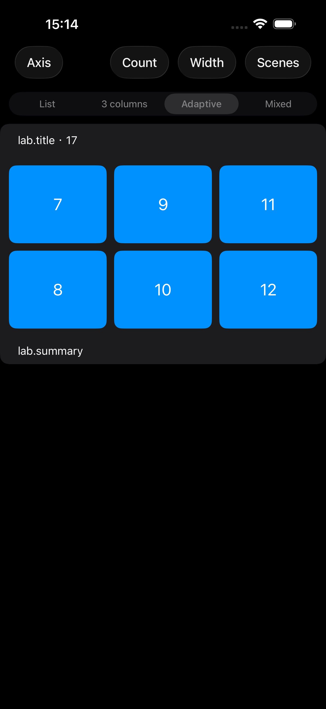
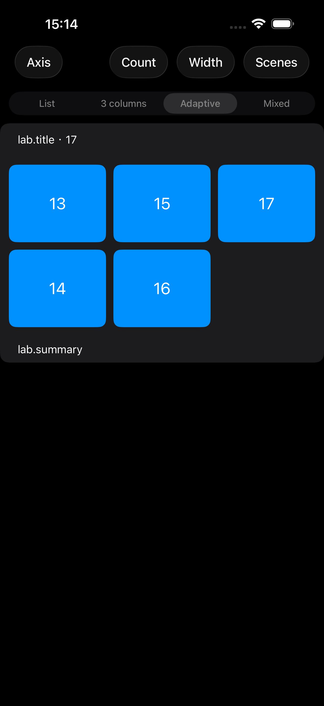
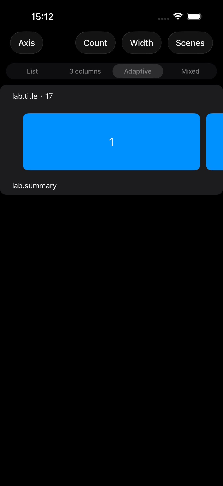
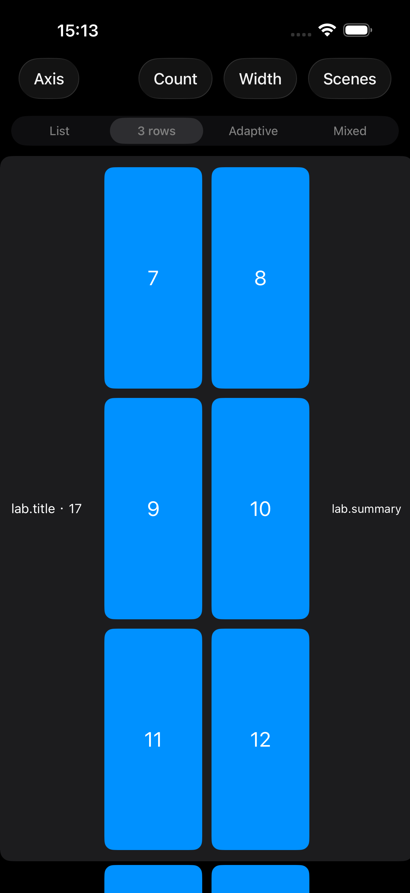

# 统一 GridLayout 验证记录

日期：2026-10-29。对应自动方向 `GridLayout(tracks:)` 重构，不替代此前 [Layout-Validation.md](Layout-Validation.md) 的历史记录。

## 最终契约

- 普通单轨道、多轨道、正交滚动共用 Grid；保留 UIKitListLayout、CustomLayout 和 EnvironmentLayout。
- 删除 ListLayout、HorizontalLayout、columns:/rows: 及旧独立模型与分支。
- 默认 `.alignment(.start)`；center/end 显式配置。对齐作用于轨道整体的交叉轴剩余空间。
- itemSize、frame、group 和 orthogonalScrolling 分别负责不同配置。
- 空布局默认仍为估算 44、间距 0 的单轨道，显式 Grid 默认正方形、间距 8。
- provider 读取当前 UIKit configuration 的方向；同一 layout 切换外层方向会重新解析。
- 现有麦位布局保留 92×112、整宽 fit group 和 continuousGroupLeadingBoundary。

完整说明及迁移见 [Layout-API.md](Layout-API.md)。后续尺寸、分页与迁移复查见 [Unified-Grid-Review.md](Unified-Grid-Review.md)；以下测试和截图保留为初始重构证据。

## 构建与测试

执行环境：Xcode，iPhone 17 Pro Max 模拟器，iOS 26.5。编译目标保持 iOS 15。

| 检查 | 结果 | 证据 |
| --- | --- | --- |
| 完整 ListKit 包测试 | 通过，271 项，0 失败 | `/tmp/listkit-grid-complete.xcresult` |
| 新增 Dynamic Type 测量测试 | 通过，1 项，覆盖单/双轨道与嵌套内容 group | `/tmp/listkit-grid-dynamic-type.xcresult` |
| 最终 Demo 单元测试 + Layout Lab UI | 通过，49 项（44 单元 + 5 UI），0 失败、0 跳过 | `/tmp/listkit-grid-demo-complete.xcresult` |
| 较早阶段 Layout Lab UI 测试 | 通过，4 项；其中包含 5 种场景 × 双外层方向 | `/tmp/listkit-grid-ui-first.xcresult` |
| 真实手势起始与居中停靠专项（已纳入最终 UI 复验） | 通过，1 项含两个场景 | `/tmp/listkit-grid-ui-anchors.xcresult` |
| iOS 15 API 编译契约 | 通过，29 个正向/预期编译失败用例 | `/tmp/listkit-api-complete.log`、`/tmp/listkit-api.Oqkr1M/` |
| DocC 编译 | 通过，无文档警告 | `/tmp/listkit-grid-docs.log` |
| 真机运行 | 未执行 | 不以模拟器结果代替真机验证 |
| iOS 15 / iOS 17 实际运行 | 未执行 | 当前使用 iOS 26.5 runtime；最低版本编译与版本可用性检查已执行 |

API 脚本中的 `fail:` 表示该非法/已移除 API 按预期无法编译，不表示脚本失败。

包测试中新增覆盖：四种方向组合、真实 item 几何、轨道对齐与 RTL 实际 cell、两行三列分页、尾组、viewport/group 比例、fill、group 留白、分页 badge、frame 覆盖顺序、数值约束、动态原生方向、混合 section 与选择保持、估算交叉尺寸。原有 self-sizing、uniform、supplementary 身份、刷新与滚动恢复回归继续运行。新增嵌套 group 的 estimated/uniform 测量与更新测试保持基本行/列的测量范围。

UI 测试使用真实手势，既验证滚动发生，也验证两行三列的分页起点与尾组尺寸、整宽 group leading 停靠及单卡片居中锚点。没有仅凭 orthogonalScrollingBehavior 枚举判定分页通过。

## Demo 路径与截图

首页 **Grid** → **Layout Lab**，或使用 `-LayoutLab` 启动参数。

- 原有 List / 3 columns（切轴后 3 rows）/ Adaptive / Mixed 控件保留。
- Scenes：Normal、Cards、Tags、Banner、Centered、2×3、Mixed sections、Native list。
- Axis：外层方向；Width：容器宽度；Count：17 / 1 / 0。
- Mixed sections 同时包含普通与正交 section；Tags 使用估算主轴尺寸。

| 两行三列停靠 | 尾组不拉伸 |
| --- | --- |
|  |  |

| 居中卡片 | 横向外层中的纵向正交分页 |
| --- | --- |
|  |  |

截图来自自动化手势测试附件。完整附件及清单保存在 `/tmp/listkit-grid-demo-complete-attachments/`。本次初始重构的源码指纹见 [source-sha256.json](Assets/UnifiedGrid/source-sha256.json)。

## 保留的失败与修复证据

- `/tmp/listkit-grid-first.xcresult`、`/tmp/listkit-grid-second.xcresult`：旧入口/断言迁移遗漏导致的编译失败，已修复。
- `/tmp/listkit-grid-third.xcresult`：旧“轴不匹配”测试前提不再成立；RTL 初次测试错误读取逻辑 attributes，后改为检验实际 cell 在窗口中的位置。
- `/tmp/listkit-grid-fourth.xcresult`：复制多个含 badge 的子 group 触发 UIKit 重复 supplementary kind 异常。现改为相应层级的重复单声明结构，保持每个 item 的 index path。
- `/tmp/listkit-grid-fifth.xcresult`：badge 断言把默认容器边缘锚定误解为中心点落在 cell 边缘。按实际 anchor 契约检查 badge 的 maxX/minY，保留精确 1 点容差。
- `/tmp/listkit-grid-direction.xcresult`：新选择保持用例未开启 Section 选择模式。补齐 `.selectionMode(.single)` 并在 apply 前后都断言已选项；未修改框架选择逻辑。

没有删除失败用例或放宽容差使测试通过。

## 明确支持边界

- frame 当前仅约束内容交叉轴。主轴 frame 或同时指定宽高会诊断；主轴 viewport 由外层 collection 提供。
- estimatedFrame 仅支持 `tracks: 1`，同时给 item/group 的交叉尺寸设置 estimated，不复刻旧 Horizontal 只估算 group 的行为。
- estimated/uniform 主轴必须使用内容推导的 group；fit 或显式 group 主轴长度会拒绝。固定容量不能由估算值保证。
- 必须保留旧估算宽度与整宽 group、复杂 fractionalWidth/fractionalHeight 父级引用或 `.none` 行为时，使用文档中的 CustomLayout 迁移方案。不会把估算值偷偷固定化。
- 异构轨道的重复 item supplementary 仍受 UIKit 限制，会在创建前诊断；同构轨道的分页 badge 已验证。
- 不新增同轴嵌套滚动协调，不承诺全部 UIKit 版本的边界吸顶和 self-sizing 行为完全相同。

## 工作区保护

操作前已备份全部 tracked 与 untracked 非忽略文件，并记录 SHA-256：
`/var/folders/_b/4kvsp2_s0ss21dbxf2_s7bnh0000gn/T/listkit-unified-grid-u8bi6q2y/manifest.json`。

本轮差异单独保存在 `/tmp/listkit-grid-turn.patch`，工作区审计在 `/tmp/listkit-grid-audit.json`。原有 `.kiro`、刷新逻辑、复用逻辑、SceneDelegate 等无关修改未被覆盖；没有删除原有文件，没有提交或推送。
