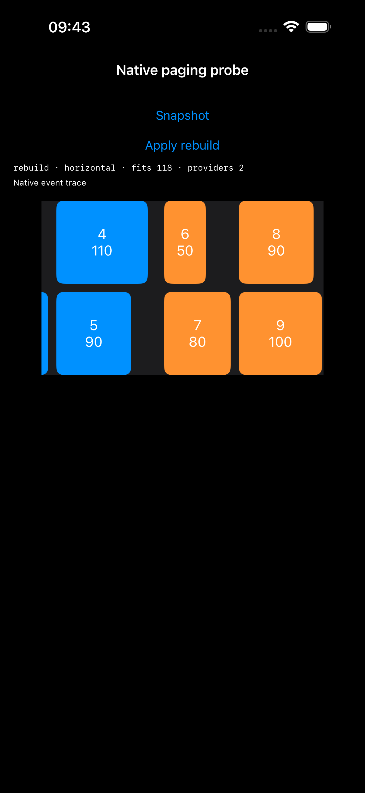
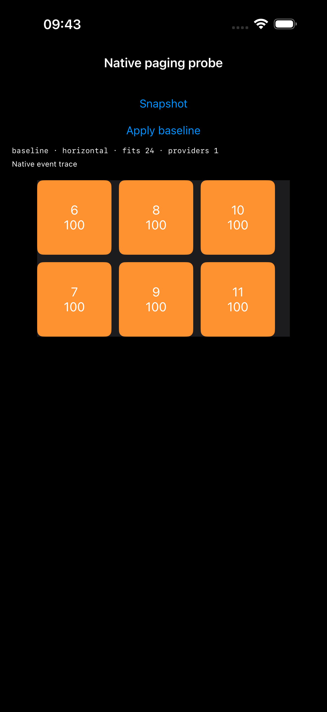

# UIKit estimated 主轴分页原型

2026-10-30。只研究原生 `groupPaging`，不修改 ListKit 库实现。

## 结论

在 iPhone 17 Pro Max / iOS 26.5 上，self-sizing 完成后执行普通布局失效、完整布局失效或重建 Compositional Layout，都没有修复分页目标。失效确实重新运行 section provider 和测量，但原生停靠仍与初始估算长度一致。固定尺寸对照组的相同真实拖拽准确停靠。

因此不建议将“测量后再 invalidate/rebuild”直接合入 ListKit 作为修复。下一步可研究显式稳定分页尺寸：测量完成后确定顶层 group 长度，继续使用原生滚动。但本原型没有实现或验收这一方案，也未证明所有 UIKit 版本都存在相同问题。

## 隔离方式

- `Examples/Examples/NativePagingProbeViewController.swift` 只 import UIKit，直接使用 UICollectionViewDataSource 和 UICollectionViewCompositionalLayout，不使用 ListKit adapter。
- 实际滚动轴的 viewport 固定 340 pt，交叉轴 210 pt，无 section/content inset、badge、固定交叉轴 wrapper 或 RTL 转换。
- 多行模板为 2 条轨道 × 3 条 line；轨道间距 10、line 间距 10、group 间距 20。
- cell 的内容视图提供确定的 intrinsicContentSize，由 Auto Layout 的 systemLayoutSizeFitting 解析主轴长度，并经 preferredLayoutAttributesFitting 返回。
- 所有组使用 `.groupPaging`。visibleItemsInvalidationHandler 只记录 offset 和属性，不写入 offset，不查找内部 scroll view，不替换 delegate，不修改减速率。
- 横向内容对应纵向外层 collection；纵向内容对应横向外层 collection。
- 干预在原点且首个 group 完成测量后由按钮执行，随后才发生真实拖拽。不会用恢复 offset 掩盖重建影响。

### 原生更新路径

| mode | 操作 |
| --- | --- |
| baseline | 无操作，只 layoutIfNeeded / 记录快照 |
| invalidate | collectionViewLayout.invalidateLayout() |
| full | invalidateLayout(with:)；自定义 invalidation context 的 invalidateEverything 返回 true |
| rebuild | 用相同 estimated 模板创建全新 UICollectionViewCompositionalLayout，setCollectionViewLayout(animated: false) |

完整失效 context 只用于扩大失效范围，没有覆盖 targetContentOffset 或分页方法。重建模式保持原始估算参数，不将实测值转换成固定 dimension。

## 实际结果

表中的“第一次 / 第二次偏差”是下一 group 首个 item 的屏幕主轴坐标与初始首个 item 坐标之差，容差始终为 1 pt。正值表示尚未到达实际边界，负值表示越过边界。

| 模板 | 操作 | 横向内容偏差（pt） | 纵向内容偏差（pt） | 结果 |
| --- | --- | --- | --- | --- |
| 固定 2×3 | baseline | 0 / 0 | 0 / 0 | 通过 |
| estimated 2×3 | baseline | 148 / 266 | 148 / 266 | 失败 |
| estimated 2×3 | invalidate | 148 / 266 | 148 / 266 | 失败 |
| estimated 2×3 | full | 148 / 266 | 148 / 266 | 失败 |
| estimated 2×3 | rebuild | 148 / 266 | 148 / 266 | 失败 |
| estimated 单 item | baseline，修正手势后 | -4 / 52 | -4 / 52 | 失败 |
| estimated 单 item | rebuild，修正手势后 | -4 / 52 | -4 / 52 | 失败 |

多行组第一批 item 长度为 `[40, 100, 60, 70, 110, 90]`，实际各 line 长度为 100、70、110，首个 group 长度 300 pt。第二组实际长度为 270 pt；前三组实际起点最终为 0、320、610。

```text
初始估算 group = 44 × 3 + 10 × 2 = 152
原生实际停靠 offset = 172、344
实际应该停靠的 group 起点 = 320、610
偏差 = 148、266
```

固定对照组每个 item 主轴 100 pt，group 长度 320，停靠 offset 为 340、680，准确到达对应 group。

单 item 组首两个 item 主轴分别为 40、100，实际起点为 0、60、180；修正手势后停靠 offset 64、128，与 `estimated(44) + groupSpacing(20)` 一致。说明问题并非只出现在多 line 嵌套结构中。

### 为什么不是“失效没有执行”

首个 group 在 initial / stable 快照中已经完成测量，所有前六个 item 的长度均有断言。随后记录到：

| 多行处理路径 | section provider 次数（干预前 → 后） | fitting 回调次数（干预前 → 后） |
| --- | --- | --- |
| baseline | 1 → 1 | 16 → 16 |
| invalidate | 1 → 2 | 16 → 36 |
| full | 1 → 2 | 16 → 36 |
| rebuild | 1 → 2 | 16 → 48 |

两个内容方向一致。失效/重建后的第三个 group 起点已经从尚未充分测量的 528 更新为 610，而停靠步长仍为 172。这个观测支持“实际布局已更新，但分页目标未随之更新”；UIKit 内部具体缓存机制仍不能从公开接口直接确认。

## 运行与复现

手动在 Examples 的 launch arguments 中加入：

```text
-NativePagingProbe -ProbeMode rebuild
```

可选参数：`-ProbeVertical`（纵向内容）、`-ProbeSingle`（单 item group）、`-ProbeFixed`（固定尺寸对照）。先点 Snapshot 确认尺寸，再点 Apply，最后手动拖动。`-LayoutLab` 原入口保持不变。

实验 UI 测试使用 `NATIVE_PAGING_PROBE` 编译条件，默认不会进入日常测试。启用后失败断言保持为失败，未使用 XCTExpectFailure、放宽容差或自动 offset 修正。运行全矩阵：

```sh
xcodebuild test \
  -workspace ListKit.xcworkspace \
  -scheme Examples \
  -destination 'platform=iOS Simulator,id=9CC16D4E-D6ED-4441-819D-53F30F278283' \
  -derivedDataPath /tmp/listkit-native-paging-build \
  -resultBundlePath /tmp/listkit-native-paging-new-run.xcresult \
  'SWIFT_ACTIVE_COMPILATION_CONDITIONS=DEBUG NATIVE_PAGING_PROBE' \
  -only-testing:ExamplesUITests/NativePagingProbeUITests
```

`resultBundlePath` 必须使用尚不存在的目录。预期当前实现仍以非零退出，表示原生分页问题被复现。

导出附件后可运行：

```sh
python3 Experiments/NativePagingProbe/analyze.py \
  <导出的附件目录> <xcodebuild日志> <输出分析JSON>
```

## 证据与失败历史

证据保存在 [Results/2026-10-30](Results/2026-10-30/)，包含完整日志、测试摘要、JSON 快照与事件、截图及运行时源码版本。原始 xcresult（含自动录像）也复制到该目录的 raw/ 下并单独忽略 Git，避免只依赖临时目录。

- 第一轮：7 个 XCTest 方法，1 个通过、6 个失败，共 24 条断言失败。固定对照、多行四种路径是有效结果。单 item 首次拖动只有 39 pt，没有翻页，不能用该次 60 pt 偏差证明吸附错误；失败记录保留。
- 补测：只修改单 item 首次拖动为 60 pt，确保 offset 实际变化。基线与重建均得到 -4 / 52 pt 偏差，两个 XCTest 方法仍失败，共 8 条失败断言。同轮原有 Demo 53 项单元测试通过。
- 第一轮之后为原型局部 helper 补充 MainActor 注解，并给实验测试增加显式编译条件；没有修改布局或滚动算法。第一轮原始源码以 first-controller.swift / first-tests.swift 留存。
- 最终分析组合第一轮有效的多行/固定结果与补测的单 item 结果；不是把整个实验标成通过。

当前结论只覆盖 iOS 26.5、LTR、两种内容方向、前两次慢速真实翻页。未执行：真机、其他 iOS runtime、快速甩动/反向/尾页、内容刷新/旋转后的分页、groupPagingCentered、continuousGroupLeadingBoundary、badge、uniform。未测试的条件不能当作通过或自动推广失败结论。

## 截图

| 重建后仍未对齐的 estimated 组 | 固定尺寸对照准确对齐 |
| --- | --- |
|  |  |

## 工作区约束

只新增实验控制器、UI 测试、分析脚本与证据，并在 SceneDelegate 增加显式 launch argument 入口。`Sources/` 下库实现与开工前的 SHA-256 清单一致。保留原有 dirty 工作区，没有暂存、提交或推送。

后续：稳定尺寸与更新事务页锚点恢复已建立独立原型，见 [稳定分页原型与证据](../StablePagingProbe/README.md)。本页失败结果保留，不视为后续方案的通过证据。
