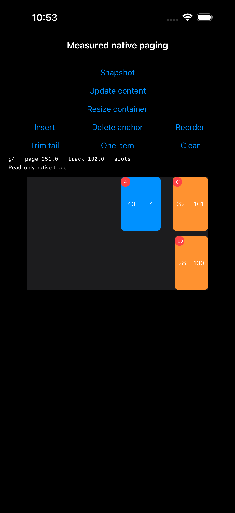
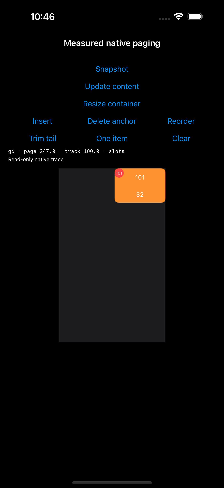

# 稳定分页：方向、badge、尾组与 identity 锚点实验

2026-10-30，iPhone 17 Pro Max 模拟器 / iOS 26.5。接续 [测量后稳定分页原型](../StablePagingProbe/README.md)。直接使用 UIKit；不修改 ListKit 实现，不提交。

## 结论与最终验收

在本原型的有限数据、固定 2 × 3 结构中，可以保留 UIKit 原生 `groupPaging`，同时支持 LTR / RTL、两个正交内容方向、真实 supplementary badge、不完整尾组和数据增删重排后的页面恢复。

通过方案包含：固定测量后的 line/page 尺寸、以 line 测量值作为 item 初始 estimate、按尾组真实内容终点补足 section 尾部留白，以及按稳定 ID 解析后调用一次公开页面恢复。item 继续使用自然 self-sizing 尺寸。不是只修改 estimated 数值，也不是修改滚动回调。

| 正交内容方向 | 验收结果 | 通过结果来源 | 真实拖拽 | 更新事务 | badge 点击 | 页边界最大误差 |
| --- | --- | --- | ---: | ---: | ---: | ---: |
| 横向 LTR | 通过 | verified | 21 | 12 | 11 | 0 pt |
| 横向 RTL | 通过 | verified | 21 | 12 | 11 | 0 pt |
| 纵向 LTR | 通过 | final | 21 | 12 | 11 | 0 pt |
| 纵向 RTL | 通过 | final | 21 | 12 | 11 | 0 pt |

以上是去除重复复测后的覆盖：84 次真实拖拽、48 次更新、44 次 badge 点击、132 条页边界检查、180 个阶段快照。四个方向均访问尾组剩余 1～5 项和完整 6 项，覆盖向末页之外拖拽、单项、空数据及清空后插入；越界 badge 请求均为 0。后继、前驱、新首项、空数据回退规则均有实际运行记录。

旧的 `testMeasuredLineSlotsWithPublicAnchor` 也在 final 轮通过：另有 12 次拖拽、8 次内容/容器更新，screen 与 offset 误差均为 0。新矩阵另外在尾页执行内容增大与容器缩窄，之后真实往返翻页。

这里合并的是不同结果包中已通过的用例，不把 final 的失败改写为成功：final 共 5 项，3 通过、2 失败；随后仅修改 badge 可见性断言，verified 中两个横向用例均通过、0 跳过、runtimeWarnings 为空。两个纵向用例已在 final 中通过更严格的旧可见性断言，本次未重复运行。两轮原型实现 SHA 完全相同，当前 UI 测试与 verified 源码快照相同；见 [acceptance.json](Results/2026-10-30/acceptance.json) 与 [audit.json](Results/2026-10-30/audit.json)。

## 验收契约

- 外层 collection 与正交内容轴相反；横向内容、纵向内容分别验证 LTR / RTL。
- 有限数据，2 条轨道 × 3 条 line，每页最多 6 项。每代先用 Auto Layout 测量，再跨页面取同一 line 的最大值；line 与顶层 group 使用确定尺寸。
- item 保持自然尺寸。所有手势后的停靠由 `.groupPaging` 完成；页面恢复仅在显式更新事务中调用一次公开 `scrollToItem`。
- 页首按逻辑 leading 对齐：横向 LTR 左边、横向 RTL 右边、纵向上边。几何断言保持 1 pt 容差。
- 末页不足 6 项也要求页首对齐；这需要明确尾部留白，不能将末页受限后的偏移当成正确恢复。
- 不访问 UIKit 内部 scroll view、不替换 delegate、不设置 contentOffset、不修改减速或 targetContentOffset。

## 锚点与数据更新

更新前从屏幕几何识别当前页，保存该页首项的稳定 ID。不是保存旧 indexPath 或页号。

更新后解析顺序为：

1. 原 ID 仍存在：保留该 ID。
2. 被删除：按更新前顺序寻找仍存在的后继。
3. 没有后继：寻找仍存在的前驱。
4. 旧数据没有任何幸存项：采用新数据第一项；新数据也为空则不滚动。

找到 ID 的新索引后，恢复它所属页的页首，而不是把该 ID 强行变成新页首。因此前插 3 项后，原 ID 6 仍在 page 1，但新页首是 ID 3；后续更新从当前页首重新取锚点。重排将锚点移到末尾时，它可能成为尾页的第二条 line，仍须真实可见、badge 可点击。

测试通过独立的旧/新 ID 数组计算预期回退，使用实际屏幕边界检查恢复结果。RTL 不依赖 native offset 的符号和原点。

RTL 原型显式设置 `flipsHorizontallyInOppositeLayoutDirection = true`、development direction 为 LTR，并强制视图 RTL 语义。本结构中横向 `scrollToItem(..., at: .left)` 恢复布局坐标的页首，最终实际位置用屏幕右边缘验收；此前改为 `.right` 的对照发生退页。这里描述的是本布局和当前系统的运行结果，不是“所有 RTL collection 都应该使用 .left”的通则。

## Badge

使用真正的 `NSCollectionLayoutSupplementaryItem`，不是 cell 内嵌伪 badge。每条 line 使用独立 kind；基础 group 使用 repeating item。原型的物理 supplementary 索引映射为：

```text
logicalItem = (physicalItem / 2) * 6 + line * 2 + physicalItem % 2
```

此映射只描述本实验的 2 × 3 固定结构，不是通用库契约。验收包括所有预期矩形进入视口的 badge 都有真实视图、实际 top/trailing 位置、重用后的稳定 ID、真实触摸回调、尾组无越界请求，以及空列表无残留视图。UIKit 可以保留视口外的 supplementary view，已存在的这些视图仍需通过身份与位置检查。

## 失败对照

所有失败仍作为失败保留，没有使用 `XCTExpectFailure`、放宽容差或删除失败断言。

| 轮次 | 结果 | 观察 |
| --- | --- | --- |
| first | 编译失败 | optional mutation closure 隐式 escaping；修正为默认非逃逸 closure，保留源码与日志 |
| matrix | 4 项 UI 测试失败，18 条断言失败 | 原恢复策略在 RTL 横向更新中退页；末页出现 93/97 pt 偏移，重排可能退一页，最大 271 pt |
| deferred | 2 项 UI 测试失败，10 条断言失败 | 延后一轮主线程执行公开恢复，仍复现上述偏移；不能据此归因于同步调用过早 |
| inset | 2 项 UI 测试失败，8 条断言失败 | `max(0, viewport - pageExtent)` 尾部留白修复完整末页；不完整尾组仍有 54 pt 偏移或退页。RTL 改用布局坐标 `.left` 后，中间页恢复正常 |
| estimate | 2 项 UI 测试失败，36 条断言失败 | item 的初始 estimate 改为测量后的 line 占位；尾组偏移仍存在，4/3/2/5 项尾组分别观察到 83/87/180/20 pt。增加尾组往返断言后，恢复失败也会导致后续页身份断言失败 |
| final | 3 项通过、2 项失败 | 两个纵向矩阵和旧尺寸更新回归通过；四方向 132 条页边界检查全部 0 pt，但两个横向用例因过宽的 badge 可见性预期失败，详见下文 |
| verified | 2 项通过、0 失败 | 原型实现不变；按 badge 自身矩形修正可见性断言，两个横向矩阵完整复测通过 |

`matrix` / `deferred` 中恢复失败后，后续拖拽是从实际错误页面继续，因此不能把这些阶段计为成功访问目标尾页。后续矩阵增加明确的尾页往返检查。

## 尾部留白方案

`estimate` 对照观察到：3 项尾组的固定 group 长度为 251，尾组真实内容终点为 164，留下 87 pt 偏移；5 项尾组最后一项短于该 line 的全局最大值，同样出现 20 pt 差值。固定 group 的配置长度不能直接当作尾组真实内容终点。

尾组修正方案使用有限数据的测量结果确定尾部空间：

```text
lastLine = ((itemCount - 1) % 6) / 2
tailContentExtent = sum(slot[0..<lastLine]) + lastLine × 10
                  + max(尾组最后一条 line 中实际 item 的测量长度)
tailReserve = max(0, viewport - tailContentExtent)
```

空数据的 reserve 为 0。横向内容设置 section 的 directional trailing inset，纵向内容设置 bottom inset；没有添加占位 item 或额外 page。测试额外向末页之外拖拽，检查是否产生空白页。

这是明确的“末页页首对齐”契约及其留白成本，不是所有产品都必须采用的默认行为。`contentInsets` 是公开的 section 边界间距 API，参见 [Apple 文档](https://developer.apple.com/documentation/uikit/nscollectionlayoutsection/contentinsets)；本实验的精确尾组行为以运行证据为准，不能从该文档推导出跨版本保证。

## Badge 可见性断言的修正

`final` 仍如实标为失败。失败发生在内容增大后的横向反向翻页：viewport 的屏幕 x 范围为 50～390，下一页两项的 x 起点为 385，因此各有 5 pt cell 可见；但它们的 trailing badge 分别位于 x=446～464、452～470，均完全在视口外。不能从 `indexPathsForVisibleItems` 推导出所有对应 supplementary view 都必须已经创建。

几何明细保存在 `Results/2026-10-30/badge-visibility-proof.json`，原始事件副本和失败截图也保留。修正后的测试从 XCUITest 实际 cell frame 独立计算预期 badge 矩形，要求所有与 viewport 相交的 badge 都有真实视图；对已创建视图继续校验身份与位置，继续执行真实点击和越界请求断言。没有改变原型实现或放宽几何容差。

## 运行与证据

源文件：

- `Examples/Examples/StablePagingProbeViewController.swift`
- `Examples/ExamplesUITests/StablePagingIdentityUITests.swift`

需要显式 `NATIVE_PAGING_PROBE` 编译条件。测试使用 XCUITest 的真实按压、拖拽与点击；每个阶段保留 JSON 状态和全屏截图，末尾附完整事件轨迹。原始 `.xcresult` 包含测试活动/录像，存放在 `Results/2026-10-30/raw/` 并忽略 Git；源码快照、导出附件、日志、摘要与分析结果保存在普通证据目录。

`analyze.py` 从导出附件和日志汇总观察，不把失败转换为通过。

手动运行 Examples，使用以下启动参数：

```text
-StablePagingProbe -StableRestorePage -StableIdentity -StableBadges
-StableTailInset -StableLogicalLeft -StableMeasuredEstimate -StableMeasuredTail
```

追加 `-StableRTL` 和/或 `-StableVertical` 切换方向。`Insert` 前插 3 项，`Delete anchor` 删除当前页首，`Reorder` 把当前页首移到末尾并反转其他数据，`Trim tail` 删除最后一项，`One item` 只保留当前页首，`Clear` 清空。更新内容、缩放容器仍使用上一轮按钮。

保留对照开关：去掉 `-StableMeasuredTail` 使用完整 page 长度计算留白；再去掉 `-StableMeasuredEstimate` 使用原始 estimated 44；去掉 `-StableLogicalLeft` 在 RTL 横向使用 `.right`；`-StableDeferredAnchor` 将恢复延后一轮主线程。不能把这些对照当作全部通过的方案。

完整矩阵与原有内容/容器回归：

```sh
xcodebuild test \
  -workspace ListKit.xcworkspace -scheme Examples \
  -destination 'platform=iOS Simulator,id=9CC16D4E-D6ED-4441-819D-53F30F278283' \
  -derivedDataPath /tmp/listkit-native-paging-build \
  -resultBundlePath /tmp/listkit-stable-identity-new-run.xcresult \
  'SWIFT_ACTIVE_COMPILATION_CONDITIONS=DEBUG NATIVE_PAGING_PROBE' \
  -collect-test-diagnostics never \
  -only-testing:ExamplesUITests/StablePagingIdentityUITests \
  -only-testing:ExamplesUITests/StablePagingProbeUITests/testMeasuredLineSlotsWithPublicAnchor
```

结果目录必须不存在。`-collect-test-diagnostics never` 禁用失败后的额外系统诊断收集，避免上一轮出现的 sysdiagnose 长时间停留；本轮 XCTest 断言、截图、JSON、测试活动和结果包仍保留。

## 适用范围

| RTL 横向：重排后的尾页，原锚点 ID 4 已移到第二条 line | RTL 纵向：尾页只剩 ID 101 |
| --- | --- |
|  |  |

只验证有限数据、固定同构轨道、静止时执行的 `reloadData + setCollectionViewLayout(animated: false)` 更新。RTL 通过视图语义与 layout flipping 显式构造，未改变设备全局语言。

未执行真机、其他 iOS 版本、异构/adaptive 轨道、Dynamic Type、异步测量、分页加载、动画 diff 更新、拖拽/减速期间更新、快速甩动或 VoiceOver。测试中的内容/容器尺寸更新使用真实 Auto Layout，但不是设备旋转测试。

此前的完整页验证不能自动推广到不完整尾组；本实验的通过也不能将“先测量”变成现有 estimated 语义的透明修复。尾部留白、全量有限测量和 ID 回退规则都需要显式契约。

本实验的通过范围不等于库级验收。本轮未运行库完整测试；只修改独立 UIKit 原型、新 UI 测试、实验文档与证据。审计发现工作区中存在其他并行 Sources/、Demo 和测试改动，均已保留并列入 audit.json，不将它们计为本轮修复。没有暂存、提交或推送。
