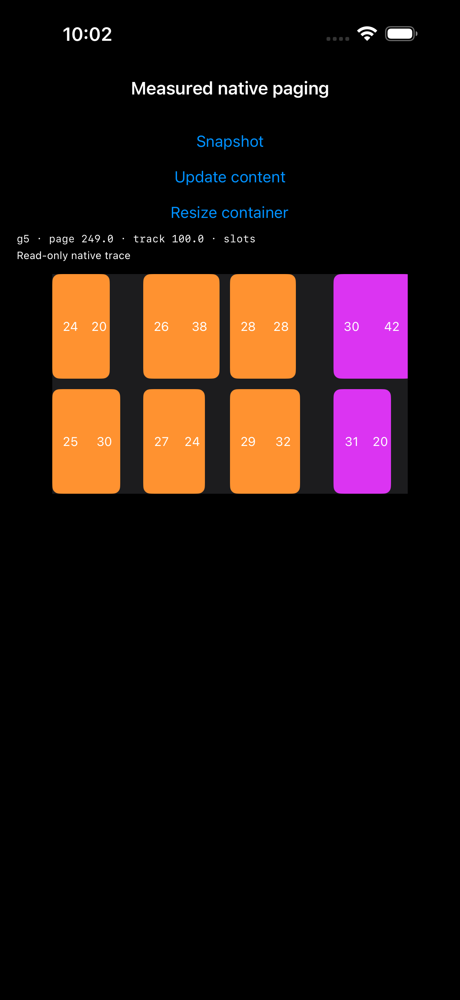
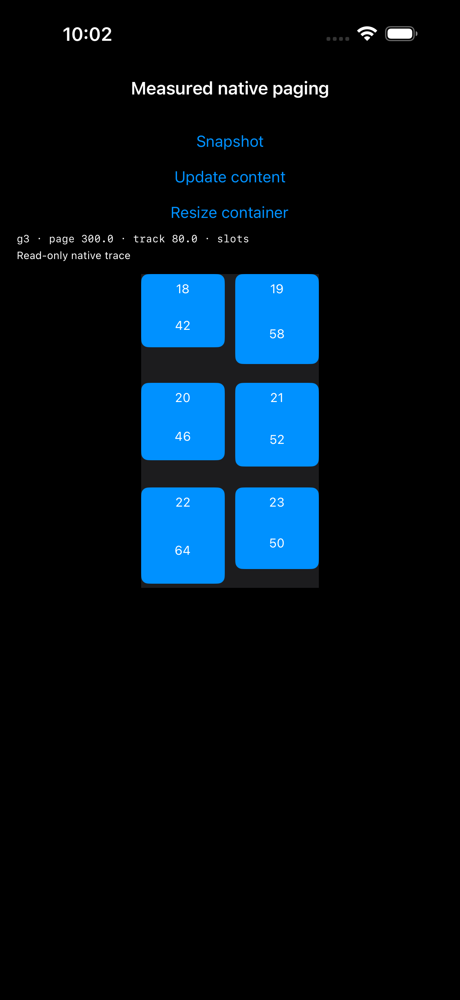

# 测量后稳定尺寸的原生分页原型

2026-10-30，iPhone 17 Pro Max / iOS 26.5。接续 [estimated 主轴失效/重建实验](../NativePagingProbe/README.md)。本轮不修改 ListKit 库实现。

后续补充实验见 [RTL、badge、尾组与 identity 锚点验证](../StablePagingIdentity/README.md)。本文保留最初 42 项完整页实验的结果与边界；后续发现的末页可滚动范围、RTL 恢复参数和数据更新回退，不能由本文的完整页通过结果替代。

## 结论

有限数据、同构轨道、静止状态更新的条件下，以下组合已通过双方向真实手势验证：

1. 用独立测量实例，在确定的轨道交叉轴尺寸下测量所有内容。
2. 跨页面取相同 line 位置的最大主轴长度，将每条 line 的占位和顶层 group 长度都确定下来。
3. item 保持自己的自然测量尺寸，较短内容允许在 line 内留白。
4. 使用原生 `.groupPaging`，不替换内部 delegate、减速或目标 offset 算法。
5. 内容/容器更新完成后，通过公开的 `collectionView.scrollToItem` 恢复一次原页面首项；随后所有拖拽、减速和吸附继续由 UIKit 完成。

最终一项 XCTest 方法在两个内容方向中执行了 **12 次真实拖拽、8 次更新事务**；原生 offset 与屏幕 item 边界误差均为 0 pt，断言容差保持 1 pt。内容增长、缩短，容器变窄、恢复及反向翻页均覆盖。

这是一个已验证的原型，不是现有 estimated 语义的透明修复：跨页统一 line 占位改变了空白分配，需要测量范围和更新锚点契约。未合入 GridLayout。

## 测量与布局

原型直接使用 UIKit，数据为 42 个 item（7 个完整页面），每页 2 条轨道 × 3 条 line。轨道间距 10、line 间距 10、group 间距 20。

内容由一个交叉轴相关的比例区域和固定长度的 caption 区域组成，约束关系为：

```text
自然主轴长度 = 轨道交叉轴长度 × 0.35 + caption 长度
```

测量通过实际 Auto Layout `systemLayoutSizeFitting` 完成；显示 cell 使用同一套内容约束。测试另用上述数学关系校验测量结果，再验证可见 cell 的实际尺寸，避免只比较同一份缓存。测量实例不调用真实 dequeue/provider。

每一代布局解析：

```text
slot[line] = max(所有页面在该 line 中各 item 的测量长度)
pageExtent = sum(slot) + lineSpacing × 2
stride = pageExtent + groupSpacing
```

顶层 group 和内部 line 使用 absolute dimension；item 仍为 estimated dimension，其拟合结果必须落在已测量的占位内。全量 7 个 group 的起点、每页首项身份、可见 item 自然尺寸与溢出条件均有断言。

初始 slot 为 `[77, 73, 79]`，pageExtent 249。内容更新将每个 caption 增长 24；容器缩窄将轨道交叉轴从 100 改为 80、viewport 从 340 改为 300。由此真实改变测量结果及分页长度，而不是只改外观。

## 结果

以下误差在横向内容与纵向内容中均为 0 pt：

| 阶段 | pageExtent | 含 20 pt 间距的步长 | 检查 |
| --- | ---: | ---: | --- |
| 初始 | 249 | 269 | 原生翻至 page 1，保持自然 item 尺寸 |
| 内容增长 | 321 | 341 | 更新后仍位于 page 1，再真实翻至 page 2 |
| 容器变窄 | 300 | 320 | 更新后仍位于 page 2，再翻至 page 3 |
| 反向拖拽 | 300 | 320 | 原生退回 page 2 |
| 内容缩短 | 228 | 248 | 更新后仍位于 page 2，再翻至 page 3 |
| 容器恢复 | 249 | 269 | 更新后仍位于 page 3，再翻至 page 4 |

“保留原页”和“下一次手势停靠”分开断言。页面恢复只发生在显式更新事务结束时，一次公开 API 调用；不是在滚动回调中持续纠偏，也不是滑动结束后的补动画。

## 失败对照与解释边界

### 固定 line/page，但不恢复页面位置

初次分页准确。但内容更新后 UIKit 保留原 269 pt offset，新 page 1 应位于 341 pt，因此出现 -72 pt 锚点误差。容器缩窄后仍保留原像素位置，出现 +21 pt 误差。

后续手势不满足“从原页继续翻到下一页”的断言：UIKit 可能先停回当前页的新边界。因此这里的失败包含更新后的页身份/对齐语义，不能都解释为新的固定步长吸附错误。加上更新事务末尾的一次公开页面恢复后，严格断言通过。

### 只固定外层 page，内部 line 仍 estimated

初次可见页面和首次翻页可以准确。失败还包括屏幕外 group 起点不稳定：例如初始理论 page 3 起点 783，尚未充分测量时返回 684，后续测量又改变起点。它没有满足本原型要求的全量稳定几何。

这些屏幕外 frame 仍是估算结果，不能仅凭这些断言宣称可见 cell 已经重叠、丢失或错误分组。本轮没有观察到可见 item 自然尺寸/溢出断言失败；也未单独验证“外层固定 + 内层 estimated + 页面恢复”是否能通过更窄的可见分页契约。当前推荐的固定 line 占位方案同时消除了这类离屏几何不确定性。

## API 与滚动所有权

- `StablePagingProbeViewController` 只 import UIKit，不使用 ListKit adapter。
- `visibleItemsInvalidationHandler` 只记录事件，不修改 offset。
- 没有访问内部正交 scroll view，没有设置其 delegate，没有设置 decelerationRate，没有覆盖 targetContentOffset。
- 布局更新采用 reloadData + setCollectionViewLayout(animated: false)，随后可选调用一次公开 scrollToItem，位置为内容方向的 `.left` 或 `.top`。
- 原型固定数据身份，使用当前 page 首项作为锚点。通用库需要用 row identity 解析新位置；数据删除/重排后的锚点回退仍待设计。

## 手动运行

Examples 启动参数：

```text
-StablePagingProbe -StableRestorePage
```

追加 `-StableVertical` 切换为纵向内容。页面按钮：Snapshot、Update content、Resize container。更新/缩放按钮再次点击会恢复原状态。

去掉 `-StableRestorePage` 可观察旧像素 offset 导致的页面偏移。追加 `-StableEnvelopeOnly` 可观察只固定外层页长的对照结构；它不是最终通过方案。

## 自动测试

测试使用显式 `NATIVE_PAGING_PROBE` 编译条件，不进入默认日常测试。只运行最终方案：

```sh
xcodebuild test \
  -workspace ListKit.xcworkspace -scheme Examples \
  -destination 'platform=iOS Simulator,id=9CC16D4E-D6ED-4441-819D-53F30F278283' \
  -derivedDataPath /tmp/listkit-native-paging-build \
  -resultBundlePath /tmp/listkit-stable-paging-new-run.xcresult \
  'SWIFT_ACTIVE_COMPILATION_CONDITIONS=DEBUG NATIVE_PAGING_PROBE' \
  -only-testing:ExamplesUITests/StablePagingProbeUITests/testMeasuredLineSlotsWithPublicAnchor
```

结果目录必须不存在。选择整个 StablePagingProbeUITests 会连同两个失败对照一起运行，当前预期非零退出；没有使用 XCTExpectFailure 或放宽容差。

## 运行记录与证据

证据位于 [Results/2026-10-30](Results/2026-10-30/)。原始 xcresult（包含自动录像）保存在 raw/ 下并单独忽略 Git；日志、测试摘要、JSON 快照/事件、截图、运行时源码快照和审计文件保留在普通证据目录。

| 轮次 | 结果 | 用途 |
| --- | --- | --- |
| first | 编译失败 | 原型属性名 constraints 与 UIView 冲突；改为 contentConstraints，保留原源码和日志 |
| geometry | 2 个 XCTest 方法失败，78 条断言失败 | 无页面恢复的两种结构，含 54 条屏幕外 group 起点断言与 24 条更新/后续翻页断言 |
| anchor | 54 项通过，0 失败 | 53 项原有 Demo 单元测试 + 1 项双方向页面恢复 UI 测试 |
| final | 1 项 UI 测试通过，0 失败 | 增加内容缩短与容器恢复；共 12 次真实拖拽、8 次页面恢复 |

anchor/final 与 geometry 的 xcresult 均已读取摘要：0 跳过、runtimeWarnings 为空。失败对照仍然记录为失败。最终没有重新运行库完整测试：本轮操作没有编辑库实现，原型行为在 Examples 中独立验证；并行源码改动不由本轮实验验证。

geometry 测试结束后，Xcode 自动启动的 simctl diagnose 长时间停留在附加诊断收集；仅对该子进程发送 SIGTERM，让父 xcodebuild 完成失败结果包写出。未终止测试运行器，78 条断言失败、截图、轨迹均保留，结果包已成功读取/导出；附加系统诊断不保证完整。诊断进程记录保存在 diagnostic-collector.txt。第一次过早导出结果包时的失败不作为损坏判断，完成写出后已重新导出。

## 截图

| 横向内容：容器恢复后原生翻页 | 纵向内容：容器缩窄后原生翻页 |
| --- | --- |
|  |  |

短 item 没有被拉伸，额外空间属于同一 line 的稳定占位。

## 后续落库前的边界

已验证的是有限 42 项、固定身份、LTR、iOS 26.5、静止时更新、无 supplementary 的原型。

未执行：真机、其他系统、RTL、badge、uniform、Dynamic Type、异步内容到达、分页加载、插入删除/重排、非完整尾页、空数据、快速甩动，以及拖拽/减速过程中更新。窗口旋转本身未执行；本轮用真实 Auto Layout 容器宽高变化覆盖尺寸重测。

若落库，应显式定义稳定分页测量策略、测量版本/环境缓存、允许的留白，以及更新事务的页身份恢复。不能将这套策略静默覆盖现有 estimated/uniform；也不能对无限数据默认全量测量。原型每次对有限数据全量重测，尚未实现生产级缓存或性能优化。

本轮只新增原型、测试、分析与证据，并增加显式启动入口。本轮操作未编辑库 Sources/。审计发现实验期间有其他并行源码改动，已原样保留并在 audit.json 中列出，不能声称整个工作区与开工前一致。最终原型源码与已通过运行时快照相符。没有暂存、提交或推送。
